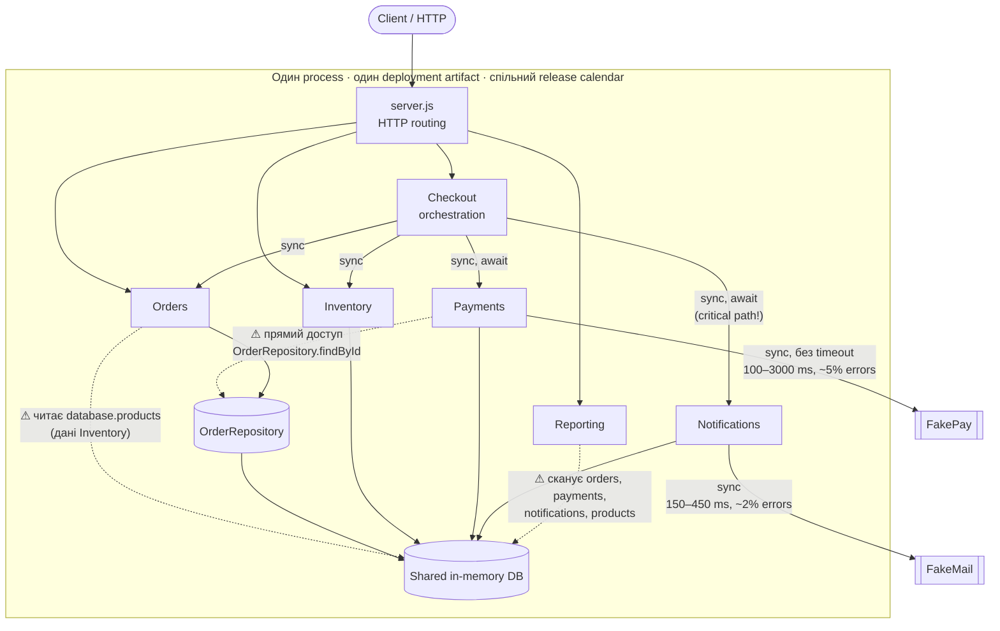
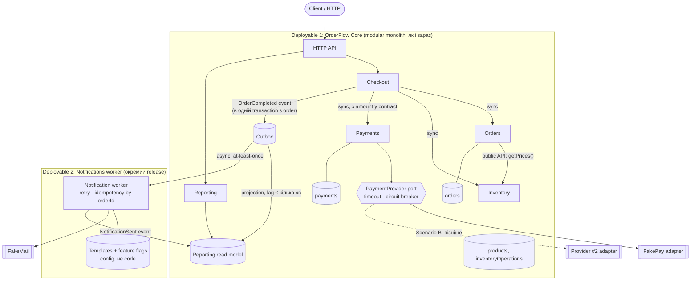

# OrderFlow: Architecture Analysis

Коротко: **залишаємо modular monolith** і робимо evolution, а не rewrite. Першим кроком прибираємо Notifications з синхронного checkout path. Також закриваємо два прямі доступи до чужих даних (Payments → OrderRepository, Orders → `products`) і ставимо payment provider за adapter з timeout. Notifications стає першим (і поки єдиним) кандидатом на independent deployment. Повний перехід на 5 services з `docs/architecture-proposal.md` **відхиляємо** для поточного етапу.

---

## 1. Current architecture



### Responsibilities та dependencies

| Module | Відповідальність | Від чого залежить зараз |
| --- | --- | --- |
| Checkout | Оркестрація: draft → reserve → charge → complete → email; compensation у `catch` | Orders, Inventory, Payments, Notifications (усе sync) |
| Orders | Створення order, зміна status | OrderRepository, **`database.products`** (чужі дані) |
| Inventory | Idempotent reserve/release | Лише власні `products`, `inventoryOperations` |
| Payments | Charge через provider, запис payment | **OrderRepository** (чужий repository), FakePay |
| Notifications | Шаблон email + sync відправка | FakeMail, shared `formatMoney` |
| Reporting | Sales summary, operational health | **Усі** operational collections напряму |

### Основні проблеми (з evidence)

1. **Email у critical path checkout.** `src/checkout/CheckoutService.js:24` чекає на `sendOrderConfirmation`. Будь-яка помилка FakeMail потрапляє в `catch` (`:32`), і там inventory вивільняється, а order отримує `FAILED`. **Перевірено запуском:** при помилці email отримуємо `order: FAILED, paymentStatus: PAID`, `payment: CAPTURED`, `stock` повернуто до 12, а клієнт бачить error. Гроші списані, а товар не зарезервований. Це суперечить business context: availability checkout важливіша за миттєвий email.
2. **Payments читає чужий repository.** `src/payments/PaymentService.js:12` звертається до `OrderRepository.findById`. Payments знає внутрішню модель Order, тому будь-яка зміна Order зачіпає Payments. Це добре узгоджується з metric «48% feature PR торкаються Orders і Payments одночасно».
3. **Orders читає дані Inventory.** `src/orders/OrderService.js:16` передає `database.products` у `calculateOrderTotal`. Ціна та stock лежать в одній структурі, якою володіє Inventory. Для Scenario F (discount rules) логіку ціноутворення доведеться розмазати між Orders, Inventory і shared.
4. **Payment provider без timeout та ізоляції.** `PaymentService.js:35` викликає provider напряму, без timeout, retry policy чи abstraction для другого provider. Два останні incidents почалися під час provider latency spikes. Scenario B (другий provider з async confirmation) зараз означає зміну всередині `chargeOrder`.
5. **Reporting працює на operational data.** `ReportingService.js` сканує всі collections, до того ж O(orders × payments). При зростанні traffic у 8–10 разів (Scenario C) він конкуруватиме з checkout за той самий process. `productPerformance` рахує revenue за **поточною** ціною product (`:48`), а не за ціною в order, тож після discount (Scenario F) звіт буде неправильним.
6. **Один deployment для всього.** Зміна email template (2–3 рази на тиждень) проходить повний regression checkout (37% змін) та потрапляє в спільний release. Metrics: release frequency впала з 5 до 2 на тиждень, lead time зріс з 2 до 6 днів, rollback rate з 2% до 9%.

### Що працює добре й не є проблемою

- **Inventory boundary** уже ізольований: idempotent `reserve`/`release` через `operationKey` (Scenario D), є тест.
- Модулі отримують dependencies через composition root `app.js`, тому providers легко підмінити в tests.
- Синхронна узгодженість Orders, Inventory та Payments в одному process дає простий і коректний compensation для payment failure.

---

## 2. Proposed architecture



### Що змінюється

| # | Зміна | Яку проблему закриває | Scenario |
| --- | --- | --- | --- |
| 1 | Checkout після `complete()` записує `OrderCompleted` в outbox і повертає відповідь. Email надсилає worker асинхронно з retry. | Помилка або latency email більше не валить checkout і не створює стан «гроші списані, order FAILED». | A, E |
| 2 | Templates та segmentation живуть у config/feature flags Notifications і можуть вимикатися без deployment Core. | Зміна template не потребує regression checkout і спільного release. | A |
| 3 | Notifications стає окремим deployable (worker). Спершу in-process consumer, а виділення в окремий deployment відбувається після того, як outbox contract стабілізується. | Незалежний release cycle для модуля, який змінюється найчастіше. | A |
| 4 | Payments отримує `{orderId, amountCents, currency}` у виклику й не читає OrderRepository. | Розрив coupling Orders↔Payments. | B, F |
| 5 | `PaymentProvider` port з timeout (наприклад 2.5 s), circuit breaker і нормалізованим error model. FakePay стає одним з adapters. | Ізоляція latency spikes; другий provider додається як adapter. | B, E |
| 6 | Orders бере ціни через public API Inventory/Catalog, а не через `database.products`. | Ownership даних; одне місце для pricing і discount. | F |
| 7 | Reporting читає власну read model (projection з events), а не operational collections. Ціна береться з order. | Reporting load не конкурує з checkout; коректний revenue з discount. | C, F |

### Що свідомо НЕ змінюється

- **Orders, Inventory, Payments і Checkout залишаються в одному deployable** з синхронними in-process викликами. Їм потрібна сильна consistency (не списати гроші без reservation, без overselling). Розподілена saga через network додала б partial failures без бізнес-вигоди.
- **Inventory boundary** уже має idempotency і власні дані. Його не чіпаємо.
- **Reporting не виділяємо в service.** Read model всередині monolith достатньо для поточного traffic. Окремий data store стане доречним, коли traffic зросте ×8–10 і p95 checkout почне деградувати під reporting load.

### Чому не 5 services (відхилення proposal)

Proposal правильно визначає напрям (contracts, data ownership, async messaging), але не перший крок. Команда має 8 engineers і не має platform team. П'ять services означають п'ять pipelines, distributed tracing, network failure modes між Orders/Payments/Inventory та eventual consistency там, де бізнес її не приймає (overselling). Кроки 1–3 з proposal беремо. Крок 4 (extract) робимо лише для Notifications, бо там вигода незалежного deployment найбільша, а вимоги до consistency найслабші.

---

## 3. Decision summary

```text
Problem    Delivery сповільнився (lead time 2 → 6 днів, release 5 → 2/тиждень, rollback 2% → 9%),
           а checkout залежить від зовнішніх providers, яким не потрібно бути на critical path.

Evidence   - CheckoutService.js:24 чекає email; при помилці email payment CAPTURED, order FAILED (перевірено).
           - PaymentService.js:12 читає OrderRepository; 48% PR зачіпають Orders + Payments.
           - 37% змін templates вимагають full checkout regression; 2-3 template зміни на тиждень.
           - 2 останні incidents стартували з payment provider latency spikes.

Decision   Зберегти modular monolith для Core. Винести Notifications з critical path через outbox
           і зробити його першим independently deployable модулем. Payments отримує contract замість
           чужого repository і provider adapter з timeout. Reporting переходить на read model.

Trade-offs + Checkout не падає через email; template-зміни релізяться окремо.
           - Eventual consistency для email (може прийти через хвилини), at-least-once доставка
             означає можливі дублікати → потрібна idempotency за orderId.
           - Новий moving part (outbox + worker), який треба моніторити (lag, dead letters).
           - Reporting дані відстають на кілька хвилин (бізнес це приймає, Scenario C).

Success    Modules Changed per Feature 4.3 → < 2.5; Change Lead Time 6 → ≤ 3 дні;
           checkout failures через notification = 0; Rollback Rate 9% → < 4%.
```

---

## 4. Principles

- **Information Hiding / Ownership.** Зараз порушено: Payments знає структуру Order (`PaymentService.js:12`), Orders знає структуру `products` (`OrderService.js:16`), Reporting знає всі collections. Proposal залишає кожен набір даних у його модуля, а назовні йдуть лише public API або events.
- **Low Coupling (temporal).** Checkout тимчасово залежить від FakeMail: щоб замовлення пройшло, email має бути доступний у ту саму мілісекунду. Outbox прибирає цю залежність.
- **Explicit Contracts.** `OrderCompleted` event і `PaymentProvider` port стають явними, versioned contracts. Саме вони дозволяють додати другий provider або змінити template без змін в Orders.
- **Design for Change.** Найчастіше змінюються templates, payment rules і discounts. Proposal ізолює саме ці місця (config templates, provider adapters, pricing в одному місці), а стабільне ядро checkout залишає як є.

---

## 5. Risks (стисло)

Assumptions: 2 000 checkout/день, середній чек $120, горизонт 1 місяць.

| Risk | Probability | Business Impact | Expected Risk Cost | Mitigation |
| --- | --- | --- | --- | --- |
| Outbox worker зупинився, customers не отримують email | 0.3/міс | ~$2 000 (support, reputation) | $600 | Alert на outbox lag > 5 хв, dead-letter queue, replay |
| Дубльований email через at-least-once | 0.6/міс | ~$300 (скарги) | $180 | Idempotency key = `orderId + template`, тест на повторну доставку |
| Timeout payment спрацював, а provider списав гроші | 0.2/міс | ~$5 000 (refund, ручний розбір) | $1 000 | Idempotency key у provider call, reconciliation job за `providerPaymentId` |
| Поточний стан (без змін): email-збій валить оплачений checkout | 2% checkout (FAILURE_RATE 0.02) ≈ 1 200 подій/міс | ~$40 на подію (ручний refund/support), без урахування втраченого repeat order | ≈ $48 000/міс | Зміна #1 |

---

## 6. Metrics та Fitness Functions

| Metric | Зараз | Ціль | Чому |
| --- | ---: | ---: | --- |
| Modules Changed per Feature | 4.3 | < 2.5 | Пряма міра coupling |
| Change Lead Time | 6 днів | ≤ 3 дні | End-to-end швидкість delivery |
| Rollback Rate | 9% | < 4% | Менший blast radius релізів |
| Checkout failures через notification | > 0 | 0 | Головна runtime-проблема |
| Template changes, що потребують Core release | 37% → full regression | 0% | Перевірка Scenario A |

**Fitness functions:**

```text
1. Dependency rule (test у CI): файли src/payments/** не імпортують src/orders/**,
   а файли поза src/inventory/** не звертаються до database.products.
2. Behavioural test: якщо notification provider кидає помилку, checkout повертає COMPLETED,
   а stock залишається зарезервованим.
3. Зміна notification template не змінює жодного файлу в src/orders/** та src/checkout/**.
4. Checkout p95 latency ≤ 3 s навіть тоді, коли payment provider відповідає довше за timeout.
```

---

## План впровадження (без зупинки feature delivery)

1. **Тиждень 1–2.** Fitness functions 1 і 2 (спочатку червоні) та провайдер-adapter з timeout для Payments.
2. **Тиждень 2–4.** Outbox + in-process notification consumer. Checkout більше не чекає email.
3. **Тиждень 4–6.** Contract для Payments (amount у виклику), pricing API в Inventory.
4. **Тиждень 6–10.** Templates у config; Notifications worker як окремий deployable. Reporting read model.
5. **Переглянути через квартал:** extract наступного модуля лише якщо metrics покажуть, що Core release досі є bottleneck.
